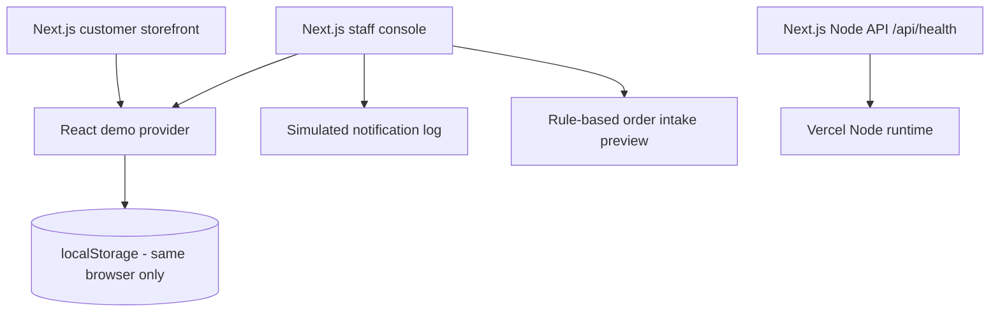
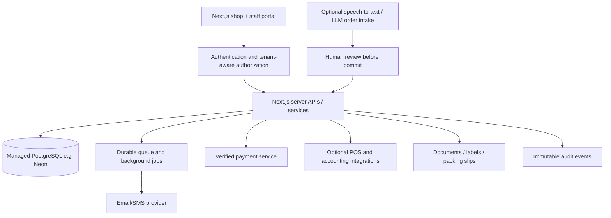

# Roadmap: from clickable demo to production-grade meat commerce operations

## Current architecture (delivered)

The application is **frontend-interactive**, not a multi-user deployed CRM. Source includes the full UX flow, demo actions and sample entities, but no real shared persistence, communications or payments. `/api/health` is a functioning Next.js Node route.

## Proposed production architecture

Recommended: modular monolith initially; split API services only when operational load justifies it. Preserve domain boundaries: `catalog`, `ordering`, `fulfillment`, `customers`, `inventory`, `billing`, `notifications`, `analytics`, `integrations`, `identity`, `audit`.

## Ordered implementation checklist

### P0 — real shared system of record

1. Managed PostgreSQL + migrations. Proposed starting schema in `database/schema.sql`; review before use.
2. Authenticated staff accounts (owner, manager, butcher, counter staff) and customer identity checks.
3. Tenant-scoped APIs; all reads and writes validated server-side; never trust `merchant_id` from client.
4. Input validation (e.g., Zod), transaction boundaries, idempotency keys, optimistic concurrency.
5. Genuine order → customer relationships, product variants and versioned price snapshots.
6. Security: secret management, TLS, rate limiting, robust session cookies, CSRF and abuse protections.
7. Audit and observability, backups, recovery tests, alerting and structured error handling.
8. Privacy notices, consent/retention/deletion workflows under applicable Canadian rules.

### P1 — sellable operating MVP

1. Customizable bilingual storefront and staff translations.
2. Availability checks, pickup-slot capacity and cut/packaging options.
3. Server-side order processing and warehouse/customer views with real-time synchronization.
4. Confirmation and ready messages via consent-aware email/SMS provider; retries and status webhooks.
5. Actual-weight capture, allowed tolerances, customer approval when price changes materially.
6. Inventory reservations/stock movements in PostgreSQL transactions (not plain decrements).
7. Exportable prep tickets, packing labels and searchable fulfillment history.
8. Pilot KPI instrumentation: capture time, error rate, pickup delay, stock waste, customer retention.

### P2 — payments and domain specialization

1. Payment-service integration, PCI scope minimization, webhook verification, dispute/refund handling.
2. Variable-weight checkout flows: deposit and approved adjustment; define customer consent and preauthorization flows.
3. Tax configuration and correct treatment of prepared foods, supplies and any fees.
4. Supplier, inventory-lot and batch traceability where the operation requires it.
5. Packing/production queues, yields, shrinkage, spoilage and recall support as appropriate.
6. B2B wholesale catalog, customer-specific prices, recurring orders and invoice terms.
7. POS/accounting synchronization with reconciliation and duplicate detection.

### P3 — AI and deeper analytics

1. Telephone integration, explicit recording/processing notices, high-quality bilingual speech-to-text.
2. Grounded catalog-aware extraction; structured schema; evidence/confidence flags; hard validation rules.
3. Human confirmation before order creation, substitution or financial action.
4. Forecasting based on enough clean actual order, stock, yield and seasonal data.
5. Demand-driven product bundles and opt-in retention messaging.

## Important meat-industry-specific requirements

- Unit of measure: kg, lb, per piece, pack, half/quarter carcass. Store original unit, conversion rules and scales resolution. Avoid adding kilograms to pieces in reporting.
- Actual versus estimated weight: snapshot prices, tolerance bands, approval and final settlement.
- Traceability: supplier, lot, receiving records, transformation batches, dates, labeling and recall events where applicable.
- Food safety: retention, storage, labeling, inspection scope and recall requirements depend on the operation. Obtain competent regulatory review; code alone does not establish compliance.
- Privacy/CASL: distinguish service/transactional messages from marketing; evidence of consent and opt-out logic where required.
- Canada/New Brunswick: confirm applicable CFIA/provincial regimes and food tax treatment for each class of product.
- Payment gateway: never store card numbers in the app; rely on appropriately certified provider flows.

## Multi-location future architecture

- `merchant_id` and `location_id` on every domain record, verified server-side.
- Role-based location permissions and delegated franchise management.
- Per-location product catalog, price lists and cutoff windows; central BI if permitted.
- Async events with an outbox pattern for reliable notifications and integrations.
- Extract independent inventory or communication service only if operational need emerges.

## Suggested pilot definition of done

A real order is created once, visible to two authenticated staff members on separate devices, weight-adjusted with an audit record, properly reserved against inventory, confirmed by a genuine transactional message, finalized through an approved payment workflow, and available in CRM/history without duplication. Observe successful failure handling, back-up recovery, and bilingual flows before taking real orders.
